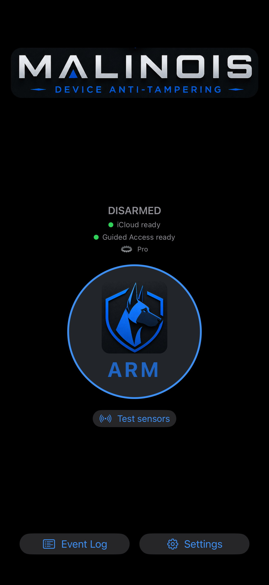
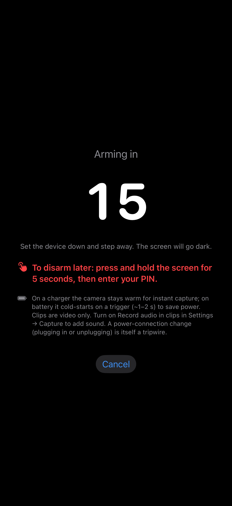
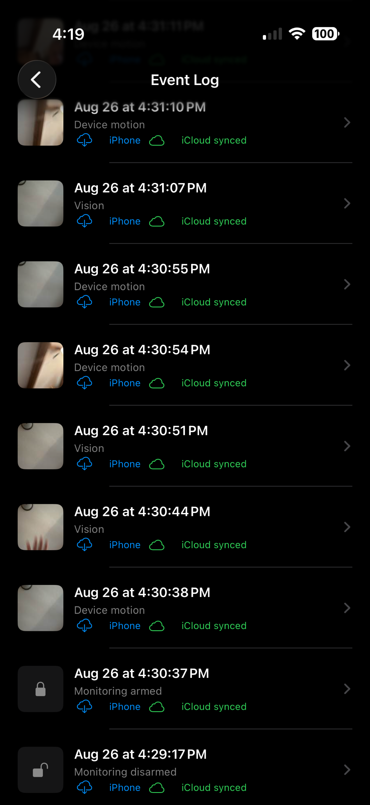

# Malinois

A covert unattended-device tamper detector for iPhone.

**[Download on the App Store](https://apps.apple.com/us/app/malinois-device-anti-tampering/id6797636246)**

Malinois needs iOS 18 or later; its Apple Watch app needs watchOS 10 or later.

<p>



</p>

*Home, the arming screen and the Event Log, as in the App Store listing.*

Malinois' singular objective is that you either:

- **A.** Return to an unattended device in the same state you left it, or
- **B.** Know that unauthorized access was attempted (or succeeded)

It is designed for that to hold even when the person who handles your phone knows your iPhone passcode. Malinois is a detector, not a lock: knowing is the goal, and the photo or clip it takes is best-effort evidence on top. It watches only while it's open on the screen.

Once armed, if the phone is moved, tilted, unplugged, handled, touched, or approached, Malinois logs a tripwire event, tries to capture a photo or clip, and writes it to a PIN-gated Event Log. Arms, disarms and tripwire events are logged with no way to delete a single entry, not even with your PIN.

> ⚠️ Use this only on **your own device**. It is a personal anti-tampering / anti-snoop tool, not a surveillance tool for other people.

**Before you rely on it:** turn on Guided Access with its Side Button option off, give Guided Access and Malinois codes of their own rather than your iPhone passcode, with Face ID and Touch ID off for ending Guided Access, turn Voice Control off if you use it, and set iOS to ask before new wired accessories connect. Malinois can check that Guided Access is on, but iOS doesn't let it see the other settings: those are up to you. Your iPhone needs a passcode too (the arming screen warns when it has none): without one, a forced restart leaves it open and clears the wait Malinois sets after wrong PINs.

**What you'll find afterwards**

| If someone… | You'll find |
|---|---|
| picks up, moves, touches, unplugs or covers the phone | An event in the Event Log: the time, the sensors that fired, and a photo or clip when the camera could take one. With Pro, verified iCloud access and a connection, the event's record reaches your iCloud before the photo, and your other devices get an alert. |
| keeps jostling or tapping it to bury the real event | One "sustained activity" record instead of a flooded log, with photos still taken on a timer. |
| tries wrong PINs | Wrong disarm PINs leave their own event, with a front-camera photo when available. |
| disarms it with your PIN | A disarm record. With Pro, your other devices get a disarm alert. |
| knows your iPhone passcode and forces a restart to get in | The phone is normally at its lock screen when you return, not Malinois's dark screen. The handling before the restart is normally recorded, and the next time Malinois runs it records "Monitoring interrupted" and that the phone restarted. |
| knows your Guided Access passcode and closes Malinois | The next time Malinois runs, it records "Monitoring interrupted". |
| deletes Malinois | The app and its log are gone, which is itself the sign. With Guided Access on, getting to the Home Screen to delete it takes one of your passcodes. With Pro, events already uploaded can survive in your iCloud; SECURITY.md says when they can't. |
| switches the phone off or destroys it straight away | With Pro and a connection, the event's record goes up before the photo, so it can reach your iCloud first. Without a connection, nothing leaves the phone. |
| blocks its signal | If the phone had a connection when you armed it and hasn't moved, losing every connection for about 30 seconds sounds the siren and leaves a signal-loss entry. |

**When you come back:** before typing your PIN, look at "Armed for" above the pad: it should match how long ago you armed. After disarming, Home's "Last armed" line should start at the time you armed; if it starts later, your session ended and another began. Then open the Event Log and read every entry since you armed, not just the newest: a disarm you didn't make, "Monitoring interrupted" or a wrong PIN means someone tried, even if the phone looks untouched.

Without Pro (free for every install during Early-Access), Malinois sends none of your events off the phone (it only asks Apple to certify the key it signs them with, which carries none of them), so a wiped or destroyed phone takes its record with it; only an earlier iOS backup might hold a copy. Sensors have thresholds and iOS can stop any app: [SECURITY.md](SECURITY.md) lists the known gaps. You can check all of this against the code: this repository holds the source of every release since 1.2, with no third-party code ([what this repository is](#what-this-repository-is), and what it can't prove).

**Check it yourself**, in a clone of this repository (`git clone https://github.com/john-comptonemail-com/malinois.git`, then `cd malinois`). The app has no networking code of its own. This searches its Swift for `URLSession`, the usual way an iOS app talks to a web server, and for web addresses, written out or built from parts:

```sh
grep -rnE 'URLSession|URLComponents|URL\(string|https?://' --include='*.swift' Malinois MalinoisEvidence MalinoisWatch MalinoisNotificationService MalinoisWatchNotificationService
```

It prints only lines from `Malinois/Support/Brand.swift`, which builds the app's three web addresses: the Help & FAQ, Privacy policy and View source rows in Settings. Each opens in Safari when you tap it; the app itself fetches nothing from them.

Anything the app itself sends goes through one of five Apple frameworks; this lists the files that use them:

```sh
grep -rlE '^import (CloudKit|StoreKit|WatchConnectivity|DeviceCheck|Network)$' --include='*.swift' Malinois MalinoisWatch MalinoisNotificationService MalinoisWatchNotificationService
```

CloudKit carries Pro's iCloud copies and alerts (the alert extension and the watch use it only to read which alert a push is, and the watch to check the account and its alert subscription); StoreKit, the Pro purchase and Apple's rating request; WatchConnectivity, the iPhone's link to its own watch; DeviceCheck, App Attest, which certifies the key the phone signs its records with; Network only watches whether a connection is up. What you send yourself is separate: Share hands a copy to iOS's share sheet.

## Try it out

To see the sensors react before you arm anything, tap **Test sensors** on the home screen: nothing is recorded and no events are logged.

1. **First run** — set a 4-digit PIN (or 6).
2. Tap **ARM**. The camera prompt appears the first time; allow it.
3. On the arming screen, **triple-click the side button** to start **Guided Access** (one-time iOS setup: Settings → Accessibility → Guided Access).
4. Tap **Start countdown**, set the device down, screen up, and go about your business. The countdown ends, sensors calibrate, and the screen goes dark.
5. **To disarm:** press and hold the screen for 5 seconds, enter your PIN, then triple-click again to end Guided Access. Evidence is in the **Event Log**.

**Enable Guided Access before you trust an armed phone unattended.** You can skip it while getting a feel for the app, but it's what stops someone from simply closing Malinois. One-time setup: Settings → Accessibility → Guided Access. Triple-click the side button on the arming screen to start Guided Access, and triple-click again after disarming to end it. In Guided Access's Passcode Settings, give it a passcode of its own and leave Face ID (or Touch ID) off: anyone who knows your iPhone passcode can add their own face or fingerprint and end Guided Access with it, and Face ID there also seems to make the open "Guided Access is not available" iOS bug more likely. In Guided Access's **Options**, turn **Side Button** off (Sleep/Wake Button on older phones), so one press can't lock the screen and pause monitoring; a press then only shows the iOS reminder, and ending Guided Access still needs its passcode, or Face ID or Touch ID if you allowed them in Guided Access's settings. Voice Control is off unless you've turned it on; if you use it, turn it off before arming, because its "Close application" command can close Malinois even under Guided Access. Optional hardening: Screen Time → Content & Privacy Restrictions → Deleting Apps → Don't Allow, behind a Screen Time passcode, since deleting the app is the one thing that destroys the on-device log.

## AI Disclosure

**I am a data engineer who wanted an app that didn't exist, but I am in no way an iOS developer.** Malinois was developed in its entirety using AI tools; primarily Fable 5, with Opus 5.5 and Fable 5.1 currently used. Rounds of adversarial reviews are performed with multiple passes from different models (currently GPT-6, Fable 5.1, GLM-5.3, DeepSeek V4.1 Flash, MiniMax M3.1 Flash, Nemotron 3.5 Super VL, etc.) until a release-ready consensus is reached, and I test on an iPhone 17 Pro, an iPhone Air and an Apple Watch Ultra 3. The majority of the documentation is also AI-generated. As with most docs these days, I find it frustrating to read at times, but I also feel it would be deceptive on my part to try and conceal it by rewriting, so I've reviewed it for obvious errors and largely left it as-is.

This is ultimately a personal project, but it's a project I think others might find a use for, and it would not have happened without AI. As such, please poke holes in the code, the assumptions and decisions I made, threat model thinking, anything and everything: I'm relying on it too.

**What you can check rather than take on trust.** Most rules in SECURITY.md are pinned by a unit test; [Where to look](#where-to-look) names the files, and the tests behind each invariant. Every release goes through adversarial reviews by other models and, lately, by outside readers of this repository; each finding and what was done about it is tracked in a numbered ledger before the fix ships. Builds are tested on two iPhones and an Apple Watch. The full test run for each release is in its [GitHub Release notes](https://github.com/john-comptonemail-com/malinois/releases). From 1.12, the full reviews' reports, and what was done about each finding, are in [reviews](reviews/README.md).

## How this is engineered

- About 39,000 lines of Swift across the app, its watch app and two extensions, and no third-party code: what you see is everything that runs.
- 2,342 unit tests in 153 files, 58,451 lines of tests. Most rules in SECURITY.md are pinned by one.
- The decisions that matter are pure functions, 283 of them, each tested on its own.
- 71 design decisions are written up as records in `docs/adr`, which the code cites ("ADR 0039").
- Fixes cite a numbered findings ledger by item number, which stays private.

## Pro

**Early-Access:** while the program is open, Pro is free for every install, permanently — no card, nothing to cancel, nothing to do. If Pro ever becomes a paid unlock, that will apply to new installs only; Early-Access installs keep everything.

A Pro in-app purchase is available, but **Pro is not required to meet Malinois' objective**: Detection, on-device capture, the local log, everything needed to fulfill that promise, is and will always be free. Pro features are "nice-to-haves" or extend the app functionality beyond the primary objective, and I believe the defaults are sufficient for the vast majority of use cases. Pro features include cloud backup/restore (each event's record reaches iCloud first, then its photo or clip, so a phone destroyed seconds later can still leave its record behind), cross-device alerts, Vision/Audio tripwires, more capture options, and helping me further enrich Anthropic investors.

With Pro, turn on iCloud's Advanced Data Protection if you want your iCloud copies readable only on your own devices.

## What's new in 1.12

- If Malinois ever has to set aside an event log it can't read in full, that log now appears at the top of the Event Log, and Home reminds you about it until it's deleted. You can view the records that can still be read, share an exact copy of the file (not signed evidence) along with its photos and clips still on your iPhone, or delete it with your PIN, together with the photos and clips only it uses; the deletion is noted in the Event Log.
- Settings now shows your iPhone's current signing key: its first eight characters, as the Mac verifier prints them, and the whole ID to copy. Give someone the ID before you send them an evidence ZIP, and they can tell it was signed on your iPhone.
- If you share a signed event and its evidence ZIP can't be included, the event's screen now tells you so, and why when it can.
- Also: a photo downloaded from another of your devices no longer shows under the wrong camera after that device updates the event; the Event Log's note that events not fully backed up to iCloud were removed to make room now appears only once per watch; and the Apple Watch app now hands back each background wake from your iPhone within 10 seconds, inside watchOS's time limit.

Earlier releases are listed in [CHANGELOG.md](CHANGELOG.md).

Solo project, no dates. If something here matters to you, or something missing does, support@comptonemail.com reaches me.

**Found something?** A security problem: report it privately, with **Report a vulnerability** on this repository's [Security tab](https://github.com/john-comptonemail-com/malinois/security) or by email ([SECURITY.md](SECURITY.md#report-a-security-issue) says what helps). A question about using the app: [Help & FAQ](https://john-comptonemail-com.github.io/malinois/support/). Issues and pull requests here aren't monitored. The app itself sends me nothing about how it's used (no analytics, no crash reporter of its own), so apart from the figures Apple gives every developer, I only hear of a problem when someone tells me.

---

## What this repository is

This is the **source of each release since 1.2**, published so the app's privacy
and security claims can be checked against the code rather than taken on
trust. Each commit here corresponds to one App Store release (1.3 has a second commit, which corrects its build number). This repository starts at 1.2; 1.0 and 1.1 shipped before it was set up and are not here. 1.0 could not have been published as shipped anyway: it was archived from a working copy with changes that were never committed, so its tag in the private repository does not have the exact source of the build (a comment in `Malinois/Support/Info.plist` says so). The app source
is byte-identical to what was submitted, with exactly one change: the developer
team ID is removed from the project file. (This README, CHANGELOG.md and the licence files
exist only in this mirror. SECURITY.md is published as written from 1.6 on;
earlier releases carried light adaptations to it.)

It is a **mirror, not a project**: development happens elsewhere, issues and
pull requests are not monitored, and the two histories never merge. New code
appears here when — and only when — a release ships.

One honest limitation: iOS offers no reproducible builds, so this repository
cannot *prove* that the binary on the App Store was compiled from exactly this
tree. What it can do is let you read what the app is designed to do — every
claim in the privacy policy and in [SECURITY.md](SECURITY.md) is checkable
against this source.

## Where to look

- **[SECURITY.md](SECURITY.md)** — a full threat model and technical reference, about 2,100
  lines: every defense mechanism, the attacks the app explicitly does *not* defend against, and how to
  report a vulnerability. If you read one file, read this one: its first part, from
  [Start here](SECURITY.md#start-here), is a practical guide of about 480 lines, and the technical reference after it is for reviewers.
- **`Malinois/`** — the app. No third-party dependencies, by design: what you
  see is everything that runs.
- **`MalinoisTests/`** — the unit tests. Most security rules in SECURITY.md
  are pinned by a test here.
- **[`reviews/`](reviews/README.md)** — from 1.12, each release's full-review reports, as the reviewers wrote them, and what was done about each finding.
- **`docs/adr/`** — the design decisions, one record each, as written when they were made; the code
  cites them by number, and [the index](docs/adr/README.md) lists them.

**A reviewer's map**, one line each:

- The PIN's storage and lockout: `Malinois/Services/KeychainService.swift`.
- The crash-durable log, its write-ahead journal and quarantine: `Malinois/Services/EventStore.swift`.
- What happens at a trip, the record before the response: `Malinois/Services/MonitoringTripResponder+Responses.swift` (`respond`).
- Which account may receive evidence, and the upload chain: `Malinois/Services/CloudEnrollment.swift` and `Malinois/Services/CloudExfiltrator.swift`.
- The disarm hold and the attribution window: `Malinois/Services/DisarmEntryCoordinator.swift`.

**Invariants**, each checkable against the code and its tests:

- The record is written and synced to disk before anything responds: before the alarm, before the camera. If that write fails, the response still goes ahead and Home reports the failure.
  Code: `Malinois/Services/MonitoringTripResponder+Responses.swift` (`respond`), `Malinois/Services/EventStore.swift` (`add`). Tests: `EngineCharacterizationTests.testTheFactIsRecordedBeforeTheCaptureAnswers`, `Item77RegressionTests.testTheBlackoutRecordExistsBeforeTheEscalation`, `EventTests.testEveryJournalAppendIsFullySyncedBeforeAddReturns`, `Item73RegressionTests.testAJournalThatCannotBeWrittenIsSurfaced`, `Item183InvariantTests.testATripWhoseRecordCannotBeWrittenStillResponds`.
- There is no delete control for the event log's records; only its size limits remove them, and SECURITY.md says which removals the log reports. An event log Malinois had to set aside can be deleted whole, with the PIN, and that leaves a status entry.
  Code: `Malinois/Services/EventStore.swift` (`pruneToCountCap`), `Malinois/Services/MonitoringEngine+AuditRecords.swift` (`deleteSetAsideLog`). Tests: `EventTests.testEventStorePrunesToCapKeepingNewest`, `Item114UnsyncedRemovalTests.testTheEngineRecordsOneMarkerOnPro`, `Item90SignerTests.testOnlyTheLimitsRemovalsAreRetiredAndAnyOtherLeavingIsDeclared`, `Item122SetAsideLogTests.testDeletesStepsAskForThePINFirstEveryTime`, `Item122SetAsideLogTests.testTheEnginesDeleteWritesAStatusEntryWithItsNumbers`.
- A Keychain that cannot be read is never taken for "no PIN": setup is never offered over a sealed one.
  Code: `Malinois/Services/KeychainService.swift`. Tests: `KeychainServiceTests.testItemReadKeepsSealDistinctFromAbsence`, `KeychainServiceTests.testASealedKeychainDefersClassificationEntirely`.
- Monitoring continues during PIN entry; only the proximity sensor pauses, and PIN keys are not touch trips.
  Code: `Malinois/Services/DisarmEntryCoordinator.swift`, `Malinois/Views/ArmedView.swift`. Tests: `Item167ReviewTests.testAnEarlyUntilClearWarningThePadHeldBackShowsWhenThePadCloses`, `DisarmEntryCoordinatorTests.testBeginOpensThePadSeedsTheGraceAndPausesProximity`, `Item183InvariantTests.testWhileThePINPadIsUpTheArmedScreenHasNoTouchLayer`.
- Detection, capture and the local log are free, and stay free.
  Code: `Malinois/Models/CoreTypes.swift` (the tripwires Pro unlocks). Tests: `Item183InvariantTests.testAFreeInstallsRecordsStayOnThePhone`, `CoreTypesTests.testIsInertWithoutProRequiresEnabledProTripwireAndNoEntitlement`.
- Without Pro, Malinois itself sends none of your events off the phone (it only asks Apple to certify its signing key; the phone's own iCloud or computer backups are separate); with it, copies and alerts go only to your own iCloud account and your own devices.
  Code: `Malinois/Services/MonitoringCloudCoordinator+Transfers.swift` (`exfiltrate`), `Malinois/Services/CloudEnrollment.swift`. Tests: `Item183InvariantTests.testAFreeInstallsRecordsStayOnThePhone`, `Item52HeartbeatTests.testTheFreeTierSendsNoBeats`, `Item57WatchRelayTests.testNothingIsSentWithCrossDeviceAlertsOffOrWithoutPro`, `CloudEnrollmentTests.testNewEvidenceCannotTransferToAnotherAccount`.

Building requires Xcode and your own signing settings; the project file ships
with no development team set.

## Checking an evidence bundle

When Malinois 1.10 or later shares an event the iPhone signed, it adds a ZIP named "Malinois evidence" with the event's date and time. To check one on a Mac with Xcode, or only its command-line tools (`xcode-select --install`), build the verifier from this repository and run it on the ZIP as you received it:

```sh
git clone https://github.com/john-comptonemail-com/malinois.git
cd malinois
swiftc -O MalinoisEvidence/*.swift MalinoisVerifier/*.swift -o malinois-verify
./malinois-verify "Malinois evidence 2026-10-31 1302.zip"
```

It prints each key Apple certified, the signatures, the counters, the export, the record's revisions and its attachments, then PASS or the problems it found. Apple's App Attestation root certificate is built in; to check against your own copy from https://www.apple.com/certificateauthority/, add `--root Apple_App_Attestation_Root_CA.pem`. Run it as an ordinary program: the certificate check uses macOS's trust service. What a check shows, and what it cannot, is in SECURITY.md ("Evidence someone else can check").

A ZIP from Malinois 1.11 or later can also include the phone's signed statement naming signatures it made and did not keep (it stopped before saving them), which the verifier reports as information, not as a problem; such a ZIP needs the verifier from 1.11 or later, since 1.10's says it is "in another format".

If Malinois on that iPhone ever had to set aside an event log it couldn't read, every ZIP the iPhone shares afterwards ends its check with problems that name that log's records, since the iPhone signed that they left the log.

## License

GPL-3.0-or-later — see [LICENSE](LICENSE), with an App Store additional
permission and a name/artwork reservation in
[LICENSE-EXCEPTION.md](LICENSE-EXCEPTION.md).
